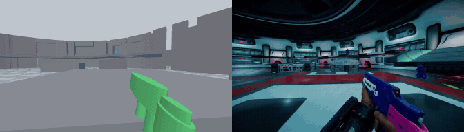
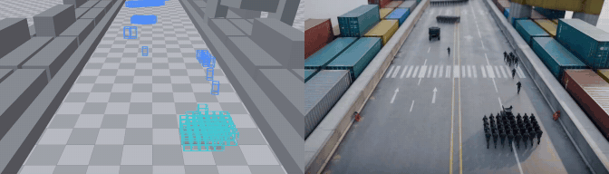
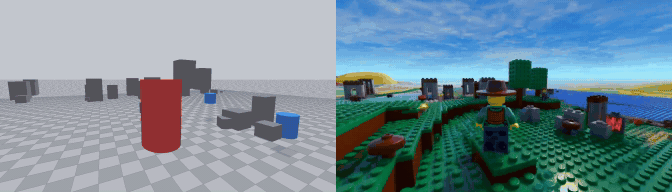
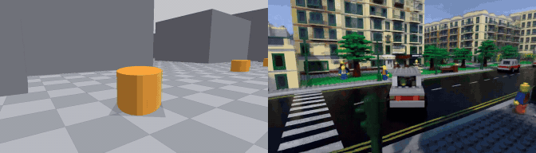
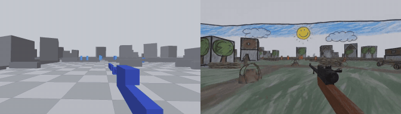
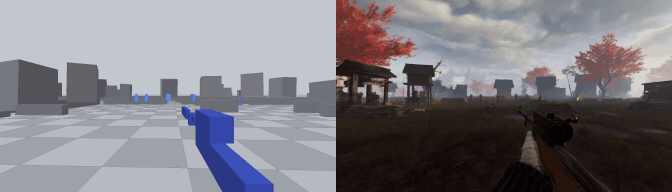
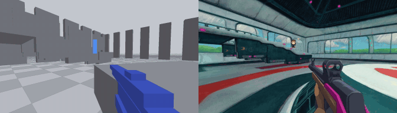
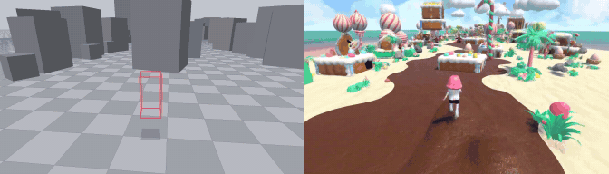
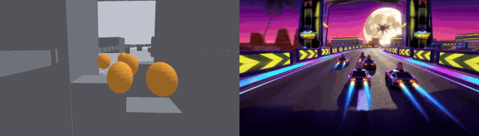
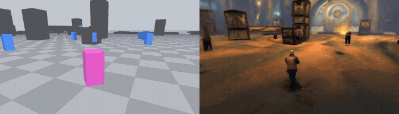

# AnyGameRenderer: Rendering Game Videos from White-Model Blockouts

Turn a **white-model video** — the untextured grey blockout of a game scene with flat-coloured proxy shapes for
characters, weapons and vehicles — plus a **caption** into a finished game video. The camera, the layout and every
proxy's position and timing are kept; what things look like comes from the caption.

Built as a LoRA on [MiniMax-H3](https://huggingface.co/MiniMaxAI/MiniMax-H3) Ref2VA (reference-video-to-video+audio,
1344×768, 24 fps). This repository is the inference package: `infer.py`, the caption builder, three example clips and
a self-contained copy of the model code.

## Highlights

- 🧱 **Blockout in, game out.** Boxes, wireframe boxes, cylinders or ellipsoids sliding over grey geometry become
  characters, weapons and vehicles in a fully rendered scene — one video reference, no depth, masks or skeletons needed.
- 🎯 **Entity-level sync.** Every proxy becomes exactly one subject that appears, moves and disappears when the proxy
  does; the camera path and scene layout are followed frame by frame.
- 🎨 **Any look from the caption.** Photoreal AAA, LEGO, Ghibli, watercolor, crayon, synthwave, samurai, candy
  land … the same white model renders in any art direction, and the characters are re-imagined to match.
- 🎮 **Any genre.** Trained and tested on first-person shooters, top-down survival, third-person action, crowds,
  vehicle racing and ball sports; held-out games render without per-game tuning.
- 📦 **Self-contained.** A 2.4 GB LoRA on the public MiniMax-H3 weights; the model code ships inside the repo
  (25 files), so nothing else has to be installed from source.

## Gallery

White model (left) · AnyGameRenderer (right). All clips are 5.2 s at 1344×768; the GIFs are downscaled.

| | |
|:--:|:--:|
|  |  |
| Academy Firefight · photoreal AAA | Harbor Breakout · photoreal AAA, 200+ soldiers |
|  |  |
| Block-o-mon · LEGO | City Roam · LEGO |
|  |  |
| Trenchfire · child's crayon drawing | Trenchfire · Ghost of Tsushima samurai |
|  |  |
| Academy Firefight · Studio Ghibli | The Great Egg Heist · candy land |
|  |  |
| Turbo Kart Grand Prix · synthwave | Kill Your Co-Workers · BioShock Art Deco |

## Quick Start

```bash
git clone https://github.com/MickeyLLG/AnyGameRenderer_infer.git
cd AnyGameRenderer_infer

bash setup_env.sh && conda activate agr   # conda env "agr": Python 3.10, torch 2.9.1+cu128, transformers 4.57.6, av …
bash download_weights.sh                  # MiniMax-H3 base weights (~123 GB) + Qwen3-VL processor files -> weights/
cp /path/to/anygamerenderer_v10ep3_lora.safetensors weights/   # the LoRA is distributed separately (2.4 GB)

bash run_example.sh                       # renders examples/*/primitive.mp4 -> examples/out/*.mp4 on GPU 0 (~17 min per clip)
```

Accept the [MiniMax-H3 Community License](https://huggingface.co/MiniMaxAI/MiniMax-H3/blob/main/LICENSE) before
downloading the base weights; `weights/README.md` lists the expected files.

Each `examples/<game>/` holds `primitive.mp4` (the white model), `spec.json`, the `caption.txt` built from it,
`ground_truth.mp4` (the real game footage the white model was captured from — never used by the model) and, for two
of them, `rendered_v10ep3.mp4`, the output of this package with the default settings (seed 42).

**Your own clip** is three steps:

```bash
python make_caption.py my_clip/spec.json -o my_clip/caption.txt          # 1. spec -> caption in the training format
echo '{"name":"my_clip","primitive":"my_clip/primitive.mp4","caption_file":"my_clip/caption.txt","out":"out/my_clip.mp4"}' > jobs.jsonl
CUDA_VISIBLE_DEVICES=0 python infer.py jobs.jsonl                        # 2-3. one process per GPU; finished outputs are skipped on re-run
```

`infer.py` options: `--steps 20` `--seed 42` `--blocks_to_swap 40` (lower on GPUs > 100 GB, 0 = no swap) `--lora ''`
(base model only) `--lora_multiplier 1.0` `--attn_mode flash3` (if FlashAttention 3 is installed) `--weights DIR`
`--processor DIR|HF-id`. Output: `out/<name>.mp4`, 1344×768, 24 fps, with the audio track H3 generates for the
soundscape line.

## Inputs and captions

**White-model video** — mp4, 24 fps, 2–15 s; 1344×768 recommended (other 16:9 sizes are resized to the 768-short-edge
canvas). The generated length is the clip length snapped down to `17n+5` frames (124 = 5.17 s, 345 = 15 s max).

- Environment: untextured **pale grey** geometry, no textures or lighting cues beyond simple shading.
- Each character / weapon / vehicle class is a **flat-coloured proxy** (box, wireframe box, cylinder or ellipsoid; one
  shape per clip) moving along the true path of that entity. One distinct, saturated colour per class: red, orange,
  yellow, yellow-green, green, cyan, blue, purple, magenta.
- Nothing else: no HUD, no text, no effects (effects are described in the caption, not drawn).

**Caption** — write a short `spec.json`; `make_caption.py` expands it into the six-section layout the model was trained
on (`python make_caption.py --template` prints a full example; the docstring documents every field):

```json
{
  "shape": "cylinder",
  "setting": "a futuristic indoor training arena: smooth white curved walls, dark teal panels, red floor stripes ...",
  "subjects": [
    {"color": "green", "desc": "the player's own weapon seen in first person: a futuristic assault rifle ...",
     "many": false, "motion": "locked to the viewpoint, swaying gently with each step"},
    {"color": "blue", "desc": "a rival cadet in a dark-grey combat suit with a visored helmet, carrying a rifle",
     "many": true, "motion": "moving as recorded"}
  ],
  "sound": "hum of arena ventilation, footsteps on hard flooring, rifle fire echoing"
}
```

What matters for sync: describe *what each proxy is* and *the setting* concretely; set `"many": true` for any class
with several proxies (crowds, enemies, rival cars); use the optional `"style"` for the art direction (lighting, medium,
era — the gallery looks were produced this way) but never describe geometry that is not in the white model; write
positive statements only — the model has no negative guidance, so "no HUD" tends to produce a HUD.

## Requirements

| | |
|---|---|
| GPU | 1× ≥ 80 GB (A100 / H100 / H20 class). Peak ≈ 50 GB while the text encoder is loaded, ≈ 32 GB during sampling with `--blocks_to_swap 40`. |
| CPU RAM | ≥ 128 GB: the 66 GB transformer is loaded on CPU for the LoRA merge and swapped blocks stay there. |
| Disk | 123 GB base weights + 2.4 GB LoRA. |
| Time | ≈ 17 min per 124-frame clip at 20 steps on H100-class (SDPA), plus ≈ 6 min one-off weight loading per process. |
| Software | Linux, CUDA 12.8 driver, Python 3.10; pinned packages in `requirements.txt`. |

## Repository layout

```
infer.py            jobs.jsonl -> mp4s; loads the weights once and loops over the jobs
make_caption.py     spec.json -> caption.txt in the exact training format
h3_media.py         white-model video decoding (24 fps resample, 17n+5 frames, model canvas)
third_party/        25-file subset of musubi-tuner (MiniMax-H3 model, VAEs, text encoder, LoRA merge, block swap) — see NOTICE.md
weights/            base weights (download_weights.sh) + the LoRA (distributed separately)
examples/           three white-model clips with spec.json, caption.txt and the original game footage
assets/gallery/     the GIFs above
```

## Notes

- Resolution and length are fixed to what the LoRA was trained on (1344×768, 124 frames); longer clips (up to 345
  frames) run but were not trained for.
- Generation is deterministic for a given seed; different seeds change appearance details, not layout.
- `third_party/musubi_tuner` is taken from [kohya-ss/musubi-tuner](https://github.com/kohya-ss/musubi-tuner) at commit
  `c4dc6b8` (its MiniMax-H3 branch). `infer.py` always imports this copy; an installed musubi-tuner is neither needed
  nor used.

## Acknowledgements

Built on [MiniMax-H3](https://huggingface.co/MiniMaxAI/MiniMax-H3) (Ref2VA backbone and VAEs, weights repacked by
[Comfy-Org](https://huggingface.co/Comfy-Org/MiniMax-H3)) and on [musubi-tuner](https://github.com/kohya-ss/musubi-tuner)
for the MiniMax-H3 model code and LoRA training.

## License

Code in this repository: see `LICENSE` (the vendored `third_party/musubi_tuner` is Apache-2.0, see
`third_party/NOTICE.md`). The base weights are released under the
[MiniMax-H3 Community License](https://huggingface.co/MiniMaxAI/MiniMax-H3/blob/main/LICENSE); the AnyGameRenderer LoRA is a
derivative of those weights and is distributed under the same terms.

## Citation

```bibtex
@misc{anygamerenderer2026,
  title  = {AnyGameRenderer: Rendering Game Videos from White-Model Blockouts},
  author = {TODO},
  year   = {2026},
  note   = {TODO: paper / project page}
}
```
