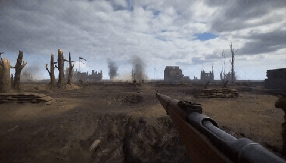
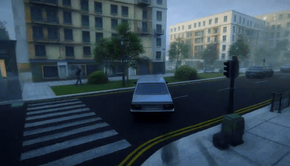
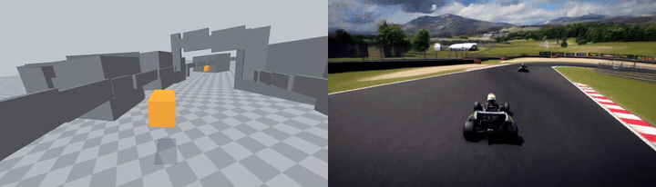
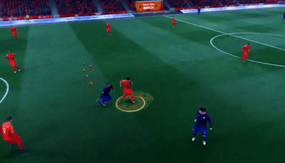
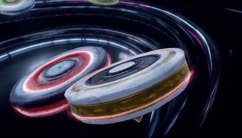
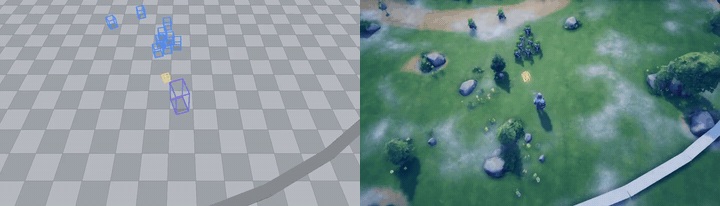
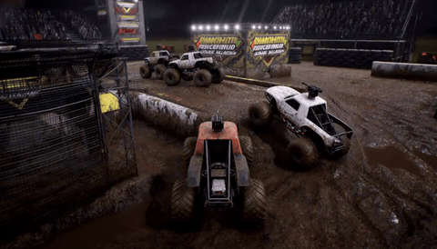
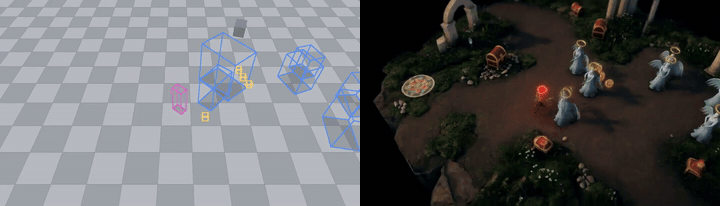
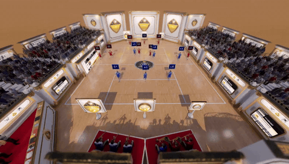
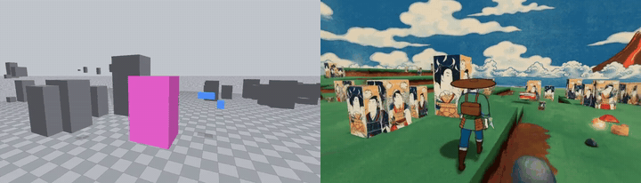

# AnyGameRenderer: One Generative Renderer from Blockout to AAA for Any Vibe-Coded Games

<p align="center">
  <a href="https://mickeyllg.github.io/AnyGameRenderer"></a>&nbsp;
  <a href="https://arxiv.org/abs/XXXX.XXXXX"></a>&nbsp;
  <a href="https://huggingface.co/MickeyLLG/AnyGameRenderer"></a>&nbsp;
  <a href="https://huggingface.co/datasets/MickeyLLG/AnyGameRenderer-Data"></a>
</p>

<!-- TODO before release: replace the four badge links above (project page URL, arXiv id, HF model repo, HF dataset repo). -->

AnyGameRenderer takes a crude gameplay recording (the "programmer art" agents produce) and a text prompt, and outputs the same gameplay re-rendered in the prompted style, frame-aligned with the input.

## Highlights

- 🎮 **Generalizes across genres:** one checkpoint renders tower defense, auto-battlers, top-down survivors, turn-based battles, kart racing, crowd runners, arena survival, co-op games, and shooters.
- 🎯 **Keeps entity correspondence:** group counts stay correct, entities appear and disappear on the right frame, and small far-away entities are not lost.
- 📹 **Its input is plain video:** gray blockouts, colored primitives, semantic maps, wireframes, and coarse mockups all work, with no per-object labels or engine hooks.
- 🎨 **Any prompted style:** photoreal AAA, LEGO, Ghibli, crayon, synthwave, samurai, candy land … with the characters re-imagined to match.
- 📊 **Measured at the entity level:** on 59 held-out cases with 753 ground-truth entities, temporal match rises from 50.9 % to 62.9 % and position match from 57.1 % to 61.9 % over the zero-shot base, while the unrendered (4.1 → 2.9 %) and hallucination (52.1 → 46.0 %) rates fall.

## Gallery: One model, every genre

| | |
|:--:|:--:|
|  |  |
| WW1 shooter | Open-city driving |
|  |  |
| Kart racing | Soccer broadcast |
|  |  |
| Spinning-top battle | Survivors-like |
|  |  |
| Vehicle combat | Dark fantasy |
|  |  |
| Fantasy ball sport | Creature battle · ukiyo-e style |

## Quick Start

```bash
git clone https://github.com/MickeyLLG/AnyGameRenderer_infer.git && cd AnyGameRenderer_infer
bash setup_env.sh && conda activate agr                          # Python 3.10, torch 2.9.1+cu128, transformers 4.57.6 …
bash download_weights.sh                                         # MiniMax-H3 base weights (~123 GB) -> weights/
cp /path/to/anygamerenderer_v10ep3_lora.safetensors weights/     # the LoRA (2.4 GB) is distributed separately
bash run_example.sh                                              # examples/*/primitive.mp4 -> examples/out/*.mp4 (~17 min per clip)
```

Accept the [MiniMax-H3 Community License](https://huggingface.co/MiniMaxAI/MiniMax-H3/blob/main/LICENSE) before downloading; each `examples/<game>/` holds the crude recording, its `spec.json` / `caption.txt`, the original game footage and (for two) the rendered output.

**Your own clip** is three commands:

```bash
python make_caption.py my_clip/spec.json -o my_clip/caption.txt          # spec -> caption in the training format
echo '{"name":"my_clip","primitive":"my_clip/primitive.mp4","caption_file":"my_clip/caption.txt","out":"out/my_clip.mp4"}' > jobs.jsonl
CUDA_VISIBLE_DEVICES=0 python infer.py jobs.jsonl                        # one process per GPU; finished outputs are skipped on re-run
```

Options: `--steps 20` `--seed 42` `--blocks_to_swap 40` `--lora ''` (base model) `--lora_multiplier 1.0` `--attn_mode flash3` `--weights DIR` `--processor DIR|HF-id`; output is `out/<name>.mp4` at 1344×768, 24 fps, with generated audio.

## Inputs and captions

**Crude recording** — an mp4 at 24 fps, 2–15 s (1344×768 recommended; length is snapped down to `17n+5` frames) of pale-gray geometry with one flat, saturated proxy color per character / weapon / vehicle class (red, orange, yellow, yellow-green, green, cyan, blue, purple, magenta), and no HUD, text, or effects.

**Caption** — write a short `spec.json` and `make_caption.py` expands it into the six-section layout the model was trained on (`--template` prints a full example); the easiest way is to give [`skills/anygamerenderer-caption/SKILL.md`](skills/anygamerenderer-caption/SKILL.md) to your coding agent (e.g. copy the folder into `.claude/skills/`) and ask it to write the spec for your clip — it inspects the proxy colors, picks the right fields and knows 45 ready-made art styles:

```json
{
  "shape": "cylinder",
  "setting": "a futuristic indoor training arena: smooth white curved walls, dark teal panels, red floor stripes ...",
  "subjects": [
    {"color": "green", "desc": "the player's own weapon seen in first person: a futuristic assault rifle ...",
     "many": false, "motion": "locked to the viewpoint, swaying gently with each step"},
    {"color": "blue", "desc": "a rival cadet in a dark-gray combat suit with a visored helmet, carrying a rifle",
     "many": true, "motion": "moving as recorded"}
  ],
  "sound": "hum of arena ventilation, footsteps on hard flooring, rifle fire echoing"
}
```

## Requirements

| | |
|---|---|
| GPU | 1× ≥ 80 GB (peak ≈ 50 GB with the text encoder loaded, ≈ 32 GB during sampling at `--blocks_to_swap 40`). |
| CPU RAM | ≥ 128 GB (the 66 GB transformer is merged with the LoRA on CPU and swapped blocks stay there). |
| Disk | 123 GB base weights + 2.4 GB LoRA. |
| Time | ≈ 17 min per 124-frame clip at 20 steps on H100-class, plus ≈ 6 min of weight loading per process. |
| Software | Linux, CUDA 12.8 driver, Python 3.10, packages pinned in `requirements.txt`. |

## Notes

- Resolution and length are fixed to what the LoRA was trained on (1344×768, 124 frames); longer clips up to 345 frames run but were not trained for.
- Generation is deterministic for a given seed, and different seeds change appearance details, not layout.
- `third_party/musubi_tuner` is [kohya-ss/musubi-tuner](https://github.com/kohya-ss/musubi-tuner) at commit `c4dc6b8` (its MiniMax-H3 branch); `infer.py` always imports this copy, so an installed musubi-tuner is neither needed nor used.

## Citation

```bibtex
@misc{anygamerenderer2026,
  title  = {AnyGameRenderer: One Generative Renderer from Blockout to AAA for Any Vibe-Coded Games},
  author = {TODO},
  year   = {2026},
  note   = {TODO: paper / project page}
}
```
